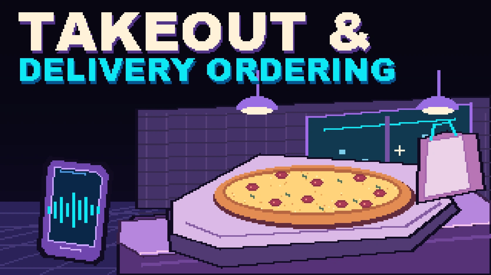

# Agora Takeout & Delivery Ordering Demo

[English](README.md) | [简体中文](README.zh-CN.md) | [日本語](README.ja.md)



サンプルメニューから品目と数量を選び、店頭受け取りまたは配達を指定し、注文の下書きを確認します。 このデモでは架空の資料を使用し、会話の結果を口頭の下書きとして伝えます。

## ローカルで実行

Node.js 24、pnpm 9.15.9、Conversational AI を有効にした Agora プロジェクトを用意します。アプリの起動前に、`.env.local` の `NEXT_PUBLIC_AGORA_APP_ID` と `NEXT_AGORA_APP_CERTIFICATE` を設定します。App Certificate はサーバー側で管理してください。

```bash
cp env.local.example .env.local
pnpm install --frozen-lockfile
pnpm run doctor
pnpm dev
```

ターミナルに表示された URL を開き、マイクの使用を許可します。

## 会話と検証

「I would like two Garden Pizzas for delivery.」と話し、数量を一つに変更して店頭受け取りに切り替えてみてください。 最後に、更新した内容の要約を依頼してください。

`pnpm run verify` でテンプレート、モック API、本番ビルドを検証できます。音声の動作はブラウザーで実際に通話して確認します。[シナリオの説明](RECIPE.md)と[npm・Vercel の設定](https://github.com/littleDogWang/agora-restaurant-ordering-demo/blob/private/docs/npm-release.md)も参照してください。
