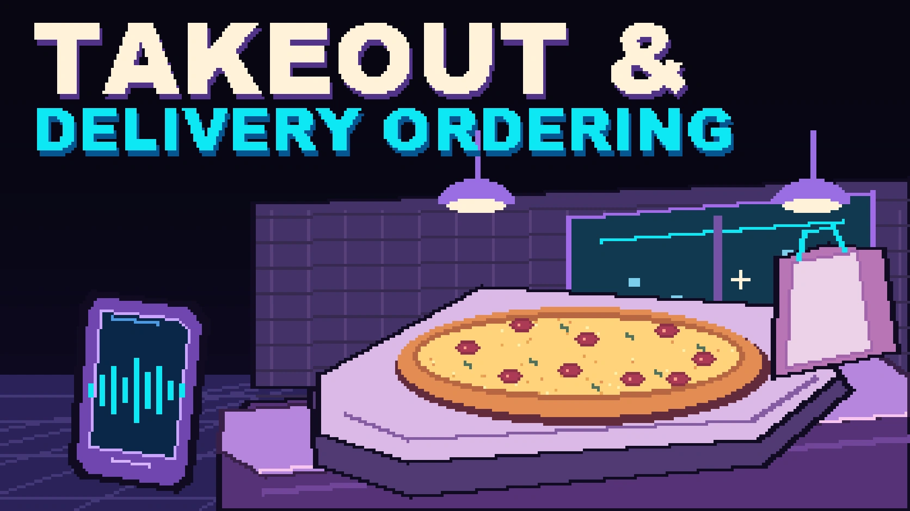

# Agora Takeout & Delivery Ordering Demo

[English](README.md) | [简体中文](README.zh-CN.md) | [日本語](README.ja.md)



Explore a sample menu and build a pickup or delivery order draft. This browser demo uses Agora Conversational AI and fictional reference material. Its output is a spoken draft for the current conversation.

## Run locally

Use Node.js 24, pnpm 9.15.9, and an Agora project with Conversational AI enabled.

```bash
cp env.local.example .env.local
pnpm install --frozen-lockfile
pnpm run doctor
pnpm dev
```

Set `NEXT_PUBLIC_AGORA_APP_ID` and `NEXT_AGORA_APP_CERTIFICATE` in `.env.local`. Keep the App Certificate server-side. Open the URL printed by Next.js and allow microphone access.

## Try it

1. Say “I would like two Garden Pizzas for delivery.”
2. Then say “Change that to one Garden Pizza and make it pickup.”
3. Ask for a recap. Check that the assistant uses the corrected details and describes the result as a draft.

Do not collect a delivery address, phone number or payment details. Do not quote an all-in total, claim delivery coverage or promise allergen safety. Do not claim an order was submitted, paid for or sent to the kitchen.

## Verify and customize

Run `pnpm run verify` for the template checks, mocked API contracts and production build. Use a real browser voice call to verify the example and correction. See [RECIPE.md](RECIPE.md) and [ARCHITECTURE.md](ARCHITECTURE.md).

Scenario inspiration is from [LiveKit's homepage examples](https://github.com/livekit/agents/tree/main/examples/homepage). This implementation uses original prompts and fictional fixtures with the Agora Top-10 template.

Maintainers can build and test the npm scaffold with `pnpm run npm:test`. See the [npm and Vercel setup](https://github.com/AgoraIO-Community/agora-restaurant-ordering-demo/blob/main/docs/npm-release.md).
