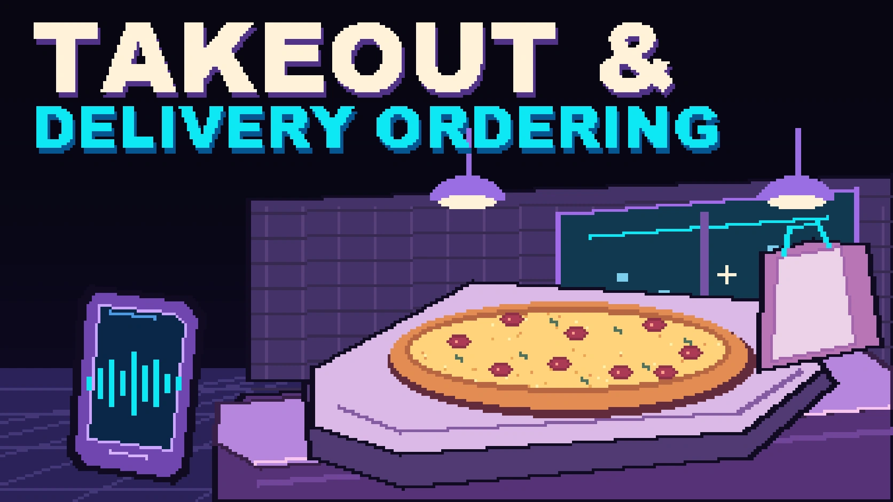
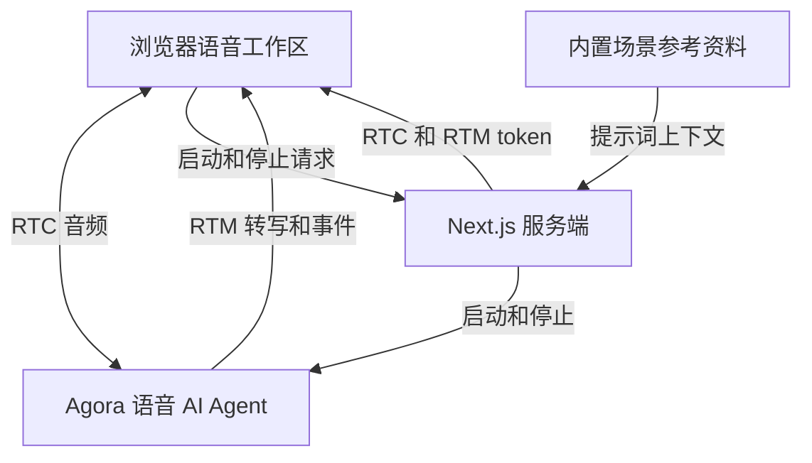

# Agora 餐厅点餐与订桌 Demo

[English](README.md) | [简体中文](README.zh-CN.md) | [日本語](README.ja.md)

本文仅翻译文档；应用界面使用英语。语音对话使用英语。

在波士顿的虚构餐厅 North Pier Pizza 点餐或订桌。路线时间使用演示数据。

**[在线试用 →](https://agora-restaurant-ordering-demo.vercel.app/)**



**[Explore more voice AI demos on Agora Recipes →](https://recipes.agora.io/)**

[](https://www.agora.io/en/products/conversational-ai-engine/)
[](https://nextjs.org/docs)
[](LICENSE)

[功能](#features) · [技术栈](#tech-stack) · [本地运行](#run-locally) · [部署到 Vercel](#deploy-to-vercel) · [使用流程](#how-it-works) · [定制](#customize) · [常见问题](#faq) · [更多](#more)

<a id="what-you-can-do"></a>
<a id="features"></a>

## 功能

- 浏览示例菜单，选择菜品和数量。
- 选择自取或配送，并在对话中修改订单。
- 配置业务工具后可确认模拟订单或订桌记录。

<a id="tech-stack"></a>

## 技术栈

- **前端：**  Next.js、React、TypeScript。
- **语音 AI：**  Agora Conversational AI、Agents SDK、RTC、RTM。
- **模型：**  Deepgram STT、OpenAI LLM、MiniMax TTS。

<a id="quick-start"></a>

<a id="run-it"></a>

<a id="try-it"></a>

<a id="conversation"></a>

## 快速开始

<a id="run-locally"></a>

### 使用 npm 创建项目

使用 Node.js 24 创建完整、可编辑的项目：

```bash
npx agora-restaurant-ordering-demo@latest my-app
cd my-app
```

然后按照下方步骤安装依赖并配置凭据。目标目录必须不存在或为空；生成器不会安装依赖或配置凭据。`@latest` 使用 npm 最新已发布版本，可能与仓库不同。维护者请参阅 [npm 发布与 Vercel 自动化说明（英文）](https://github.com/AgoraIO-Community/agora-restaurant-ordering-demo/blob/main/docs/npm-release.md)。

### 本地运行

通过 `RESTAURANT_TOOL_ORIGIN` 配置可访问同一个 Next.js 进程的公开 HTTPS 地址以启用业务工具。默认提供菜单查询和口头草稿。

需要 Node.js 24、pnpm 9.15.9，以及已启用 Conversational AI 的 [Agora 项目](https://console.agora.io/)。

**1. 安装与配置**

克隆或下载本仓库，然后在仓库目录打开终端。如果已用 npm 创建项目，直接在生成的目录继续。

```bash
pnpm install --frozen-lockfile

if [ ! -f .env.local ]; then
  cp env.local.example .env.local
fi
```

在 [Agora Console](https://console.agora.io/) 创建或选择项目。打开 **Manage credentials**，将 **App ID** 和 **Primary certificate** 复制到 `.env.local`（[操作说明](https://docs.agora.io/en/introduction/console-setup)）：

```dotenv
NEXT_PUBLIC_AGORA_APP_ID=your_agora_app_id
NEXT_AGORA_APP_CERTIFICATE=your_agora_app_certificate
```

默认语音和语言模型无需单独配置 API Key。App Certificate 仅限服务端使用，请保存在 `.env.local`，不要暴露在浏览器代码中。配置模板见 [env.local.example](env.local.example)。

**2. 启动应用**

```bash
pnpm run doctor
pnpm run dev
```

打开 [http://localhost:3000](http://localhost:3000)，选择 **Talk to the order desk** 并允许使用麦克风。需要时可请助手总结对话，点击挂断按钮（**End session**）结束。

每次会话满 10 分钟自动结束，点击 Start again 可重新开始。

<a id="deployment"></a>

<a id="deploy-to-vercel"></a>

### 部署到 Vercel

[](https://vercel.com/new/clone?repository-url=https%3A%2F%2Fgithub.com%2FAgoraIO-Community%2Fagora-restaurant-ordering-demo&env=NEXT_PUBLIC_AGORA_APP_ID%2CNEXT_AGORA_APP_CERTIFICATE&envDescription=Agora%20App%20ID%20and%20App%20Certificate%20from%20Agora%20Console.%20Enable%20Conversational%20AI%20for%20the%20project.&envLink=https%3A%2F%2Fdocs.agora.io%2Fen%2Fintroduction%2Fconsole-setup&project-name=agora-restaurant-ordering-demo&repository-name=agora-restaurant-ordering-demo)

1. 点击按钮，将本仓库克隆到你的 Git 账户并导入 Vercel。
2. 选择 **Next.js** 和 Node.js 24。
3. 在 **Environment Variables** 中填写 `NEXT_PUBLIC_AGORA_APP_ID` 和 `NEXT_AGORA_APP_CERTIFICATE`，然后部署。

Community 官方演示站通过 GitHub Actions 在验证通过后部署生产环境。仅修改 README 或文档不会部署；`main` 上的应用、静态资源、依赖和构建配置变更会触发部署。凭据、路径过滤和手动部署详见[维护者部署说明（英文）](https://github.com/AgoraIO-Community/agora-restaurant-ordering-demo/blob/main/docs/npm-release.md#production-website-deployment-with-github-actions)。生产部署 workflow 仅在 Community 仓库运行。

<a id="how-it-works"></a>

## 使用流程

1. 选择 **Talk to the order desk** 并允许麦克风访问。
2. 试说 “I would like two Garden Pizzas for delivery.”
3. 接着说 “Change that to one Garden Pizza and make it pickup.”
4. 请助手复述，检查口头草稿是否采用更新后的要求。

### 架构



Next.js 签发浏览器 token，并在启动 Agora Agent 时提供场景指令。对话行为由提示词驱动，未连接实时业务系统。详见 [ARCHITECTURE.md](ARCHITECTURE.md)。

<a id="faq-and-limitations"></a>

<a id="faq"></a>

## 常见问题

### 可以尝试什么？

I would like two Garden Pizzas for delivery.

### 能力范围是什么？

浏览示例菜单，选择菜品和数量。 选择自取或配送，并在对话中修改订单。 配置业务工具后可确认模拟订单或订桌记录。

### 哪些内容不会实际执行？

演示无法下单、收款、确认配送范围或保证过敏原安全。请使用虚构信息，避免提供联系方式或支付信息。 演示不会计算最终总价或把草稿发送到厨房。

### 为什么无法启动语音会话？

检查浏览器麦克风权限、输入设备、Agora App ID、App Certificate 和 Conversational AI 权限。请使用 localhost 或 HTTPS。运行 `pnpm run doctor` 检查本地配置，再按页面错误提示重试。

### 可以保存对话副本吗？

可以。在 Inspector 中选择 **Export session evidence**，将当前或最近一次通话下载为 JSON。请在开始新通话或刷新页面前导出。

<a id="customize"></a>

### 如何让演示更贴近真实业务？

通过 [RAG](https://docs.agora.io/en/ai/build/custom-model-integration/custom-llm)、[工具调用](https://docs.agora.io/en/ai/build/tools/custom-tools)或 [MCP](https://docs.agora.io/en/ai/build/tools/mcp-tools) 连接自己的知识库和业务服务。 添加工具时，在 [Agent 配置](app/api/invite-agent/route.ts)中将 `advancedFeatures.enable_tools` 设为 `true`。

### 如何适配自己的场景？

按你的场景定制 Agent 提示词、业务工具和界面。

### 怎样验证改动？

运行 `pnpm run verify` 检查模板、模拟 API 契约和生产构建。通过实际浏览器语音通话验证对话。详见[场景指南](RECIPE.md)。

## 许可与来源

采用 [MIT License](LICENSE)。请保留[第三方声明](THIRD_PARTY_NOTICES.md)。

场景灵感来自 [LiveKit 首页示例](https://github.com/livekit/agents/tree/main/examples/homepage)，采用独立编写的提示词和虚构示例。

<a id="more"></a>

## 更多

- **[Recipes](https://recipes.agora.io/)：** 探索更多 Agora 演示与集成。
- **[Docs](https://docs.agora.io/en/ai)：** 学习构建和扩展语音 Agent。
- **[Console](https://console.agora.io/)：** 创建项目，管理凭据和用量。
